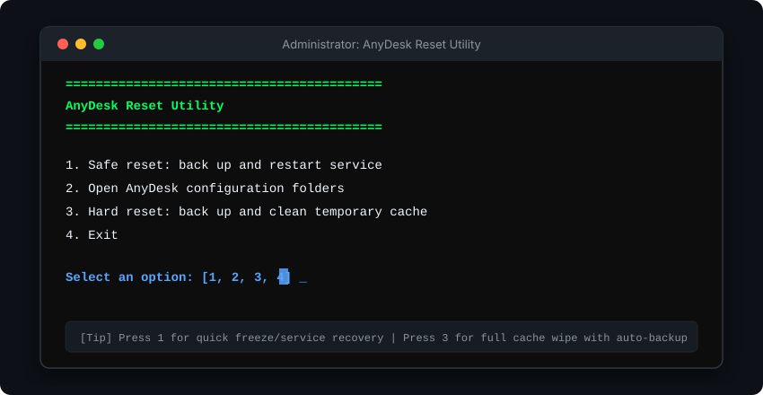

# AnyDesk Reset Utility (with Interactive Options)

[](https://github.com/arybishal/Reset-Anydesk-with-Option)
[](https://github.com/arybishal/Reset-Anydesk-with-Option)
[](LICENSE)

<p align="center">
  
</p>

An intelligent, multi-option Windows utility script to safely restart, inspect, or thoroughly clean AnyDesk temporary caches with **automatic backup** prior to any changes.

---

## 📸 Interface Preview

<p align="center">
  
</p>

---

## ✨ Features & Menu Options

When you run `reset-anydesk.bat`, an interactive menu with 4 options is presented:

### 1️⃣ Option 1: Safe Reset (Restart Service)
* **What it does:** Safely stops and restarts the background Windows `AnyDesk` service via PowerShell.
* **Safety:** **100% Non-destructive.**
* **Preserves:** AnyDesk ID, connection history, passwords, whitelist, and settings are completely untouched.
* **Best used for:** Fixing frozen sessions, unresponsive remote incoming connections, or general connection glitches.

### 2️⃣ Option 2: Open Configuration Folders
* **What it does:** Automatically opens all relevant AnyDesk storage and configuration directories in Windows File Explorer:
  - System directory: `%ProgramData%\AnyDesk`
  - Roaming User directory: `%APPDATA%\AnyDesk`
  - Local User directory: `%LOCALAPPDATA%\AnyDesk`
* **Best used for:** Inspecting configuration files (`system.conf`, `user.conf`), reviewing trace logs, or manual troubleshooting.

### 3️⃣ Option 3: Hard Reset (Cache Wipe + Auto-Backup)
* **What it does:**
  1. Prompts for explicit user confirmation (`Y/N`).
  2. **Automatically creates a full backup** of both User and System AnyDesk configurations onto your Desktop in a folder named `AnyDesk-Backup-<RandomID>` using `robocopy`.
  3. Stops the background `AnyDesk` service.
  4. Purges corrupt or bloated temporary cache directories:
     - `%TEMP%\AnyDesk`
     - `%LOCALAPPDATA%\AnyDesk\cache`
     - `%APPDATA%\AnyDesk\thumbnails`
* **Safety:** The script backs up your configuration first. It deliberately does **not** erase your credentials, identity, or registry keys.
* **Best used for:** Resolving display/thumbnail corruption, bloated disk cache, or persistent connection errors.

### 4️⃣ Option 4: Exit
* Exits the utility without executing any actions.

---

## 🚀 How to Run the Script

### Method 1: Direct Batch File (Recommended)
1. Download or clone this repository:
   ```cmd
   git clone https://github.com/arybishal/Reset-Anydesk-with-Option.git
   ```
2. Right-click on [`reset-anydesk.bat`](reset-anydesk.bat) and choose **"Run as administrator"**.
3. Type the number corresponding to your choice (`1`, `2`, `3`, or `4`) and press Enter.

### Method 2: Command Prompt / PowerShell
Open an elevated terminal (Admin) and run:
```cmd
cd path\to\Reset-Anydesk-with-Option
reset-anydesk.bat
```

> [!IMPORTANT]
> **Administrator Privileges Required:** Restarting Windows services (`Get-Service AnyDesk`) and managing system directories (`%ProgramData%\AnyDesk`) requires elevated administrative permissions. The script includes an automated check (`fltmc`) and will notify you if elevation is missing.

---

## 📁 Repository Structure

```text
Reset-Anydesk-with-Option/
├── assets/
│   ├── banner.svg         # High-resolution repo header banner
│   └── cli-preview.svg    # Console workflow mockup preview
├── reset-anydesk.bat      # Ready-to-run executable batch script
├── Reset Any Desk.MD      # Reference copy of the script
├── README.md              # Documentation and guide
└── LICENSE                # MIT License
```

---

## 🛡️ Backup & Restore Note

If you choose **Option 3 (Hard Reset)**, your original files are safely copied to:
```text
C:\Users\<YourUsername>\Desktop\AnyDesk-Backup-XXXXX\
├── System\   (from %ProgramData%\AnyDesk)
└── User\     (from %APPDATA%\AnyDesk)
```
If you ever need to restore your backed-up settings, simply copy the files back to their respective directories.

---

## 📄 License

This project is licensed under the [MIT License](LICENSE).
