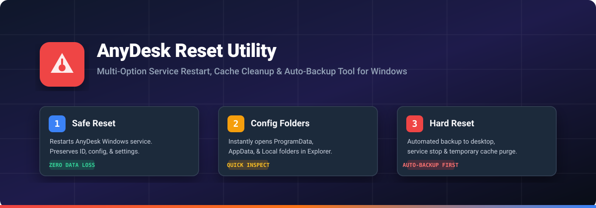

# Any Reset - AnyDesk Maintenance and Factory Reset Utility

[](https://github.com/arybishal/Reset-Anydesk-with-Option)
[](https://github.com/arybishal/Reset-Anydesk-with-Option/releases/latest)
[](reset-anydesk.bat)
[](LICENSE)

<p align="center">
  
</p>

Any Reset is a dedicated Windows software application designed to inspect, clean, and completely reset AnyDesk installations to their original factory state with an assigned brand-new AnyDesk ID. Engineered with a high-contrast White and Yellow design, automated pre-clean backups, and built-in GitHub update delivery.

---

## Direct Download

Download the pre-compiled standalone executable. No installation or runtime dependencies required:

**[Download Any Reset v1.0.0 Portable (.exe)](https://github.com/arybishal/Reset-Anydesk-with-Option/releases/latest/download/Any.Reset-v1.0.0-Portable.exe)**

---

## Design System

Any Reset is designed with a high-contrast visual layout:
* Primary Canvas: Clean White background with sharp black borders.
* Action Controls: High-visibility Electric Yellow buttons with bold black labels.
* Integrated Windows Titlebar: Native drag region, custom window controls, and an in-app update check shortcut.
* Real-Time Telemetry Bar:
  - Current AnyDesk ID detection with one-click clipboard copying.
  - Windows AnyDesk Service monitor displaying active status with quick toggle.
  - Process monitor displaying active AnyDesk tasks with a force-terminate shortcut.
  - Quick action launcher for AnyDesk and an administrative elevation shortcut.

---

## Core Features

### 1. Granular Scanner and Cleaner
Inspects all known storage locations used by AnyDesk across the operating system:
* Local Session Cache: Directory containing render caches, streaming chunks, and display buffers.
* Roaming User Cache: Temporary session files stored within the roaming profile.
* System Service Cache: Service-level caches located in ProgramData.
* Windows Temp Storage: Runtime executables, unpacked libraries, and clipboard buffers.
* Remote Desktop Thumbnails: Screenshot previews generated for speed-dial tiles.
* Diagnostic Trace Logs: Detailed client and service event traces (ad.trace, ad_svc.trace).
* Connection Logs: Inbound and outbound remote connection records (connection_trace.txt).
* User Configuration: Stored speed-dial entries, address books, and user settings (user.conf).
* Session Chat Logs: Saved conversation transcripts exchanged during remote sessions.
* System Identity Tokens: Hardware fingerprints and configuration files that store the unique client ID (system.conf, service.conf).
* Windows Registry: Settings and values stored under Current User.

Scanning displays exact file counts and byte sizes for every item. Users can select items individually or apply presets: All, Cache and Logs Only (Safe), User History, or None.

### 2. Complete Factory Reset
Restores AnyDesk to an out-of-the-box state, equivalent to a clean installation on a new computer:
1. Automatic Safety Backup: Preserves the existing installation state in a timestamped backup directory.
2. Process Termination: Stops all active background and foreground AnyDesk tasks.
3. Service Management: Stops the AnyDesk Windows service.
4. Identity and Cache Purge: Deletes existing client identifiers, encryption tokens, caches, and session histories.
5. Registry Clean: Clears user registry references.
6. Service Re-initialization: Restarts the service. When AnyDesk starts again, it communicates with the network relay to register a brand-new AnyDesk ID.

### 3. Integrated GitHub Auto-Updater
Any Reset includes an integrated release delivery system:
* Check for Updates: Query the official GitHub repository releases directly from the titlebar or the utilities panel.
* Release Notes Display: Inspect new release details, version numbers, and file sizes before downloading.
* In-App Streaming Download: Downloads updated executables directly with real-time percentage and byte trackers.
* Instant Launch: Run the newly downloaded release and restart the application with one click.

### 4. Backups and One-Click Restore Hub
* Automatic Snapshots: Full backups of both ProgramData and AppData configurations are created before every cleanup or reset.
* Snapshot History: View previous backups with creation dates, original AnyDesk IDs, file counts, and total sizes.
* One-Click Restore: Restore any previously backed-up configuration and recover earlier AnyDesk IDs immediately.
* Explorer Access: Quick-open button to explore backup archives directly in Windows Explorer.

### 5. Diagnostics and Service Control
* Safe Reset: Restarts the AnyDesk Windows service without modifying any configuration or resetting the ID. Used to recover frozen incoming sessions.
* Process Termination: Immediately closes hanging or unresponsive AnyDesk tasks.
* Directory Navigation: One-click shortcuts to open ProgramData, AppData Roaming, LocalAppData, and Temp storage folders.
* Command-Line Script: The legacy interactive batch script (reset-anydesk.bat) is maintained in the repository for headless or console environments.

---

## Getting Started

### Method 1: Portable Standalone Executable (Recommended)
1. Download `Any.Reset-v1.0.0-Portable.exe` from the latest release.
2. Double-click the file to run. No setup wizard or external runtimes are required.

### Method 2: Running from Source
```bash
# Clone the repository
git clone https://github.com/arybishal/Reset-Anydesk-with-Option.git
cd Reset-Anydesk-with-Option

# Install dependencies
npm install

# Start the application
npm start
```
Alternatively, double-click `Start-AnyReset.bat` to launch the application.

### Method 3: Interactive Command-Line Script
For environments without a graphical interface:
1. Right-click `reset-anydesk.bat`.
2. Select "Run as administrator".
3. Choose from the numeric menu options.

---

## Technical Specifications

| Property | Details |
| :--- | :--- |
| Operating System | Windows 10 / Windows 11 / Windows Server (x64) |
| Architecture | x86-64 |
| Application Framework | Electron 45, Node.js |
| Security Model | asInvoker execution level with optional in-app UAC elevation |
| Packaging Format | Standalone portable executable (.exe) |
| External Dependencies | None (All icons, styles, and scripts are bundled natively) |

---

## Repository Structure

```text
Reset-Anydesk-with-Option/
├── assets/
│   └── banner.svg             # High-resolution vector header banner
├── dist/
│   └── Any Reset-v1.0.0-Portable.exe
├── src/
│   ├── index.html             # Application interface structure
│   ├── style.css              # White and yellow design system
│   └── renderer.js            # Frontend logic and updater integration
├── main.js                    # Core background process and Windows API bindings
├── preload.js                 # Secure context bridge
├── reset-anydesk.bat          # Legacy interactive batch utility
├── Start-AnyReset.bat         # Windows development launcher
├── package.json               # Application metadata and build configuration
└── README.md                  # Documentation
```

---

## License

This software is released under the [MIT License](LICENSE).
